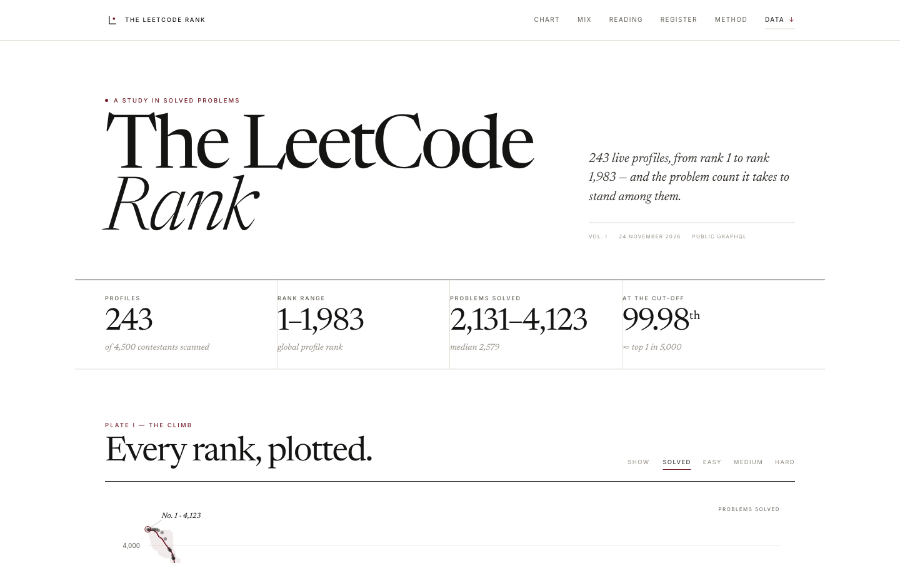
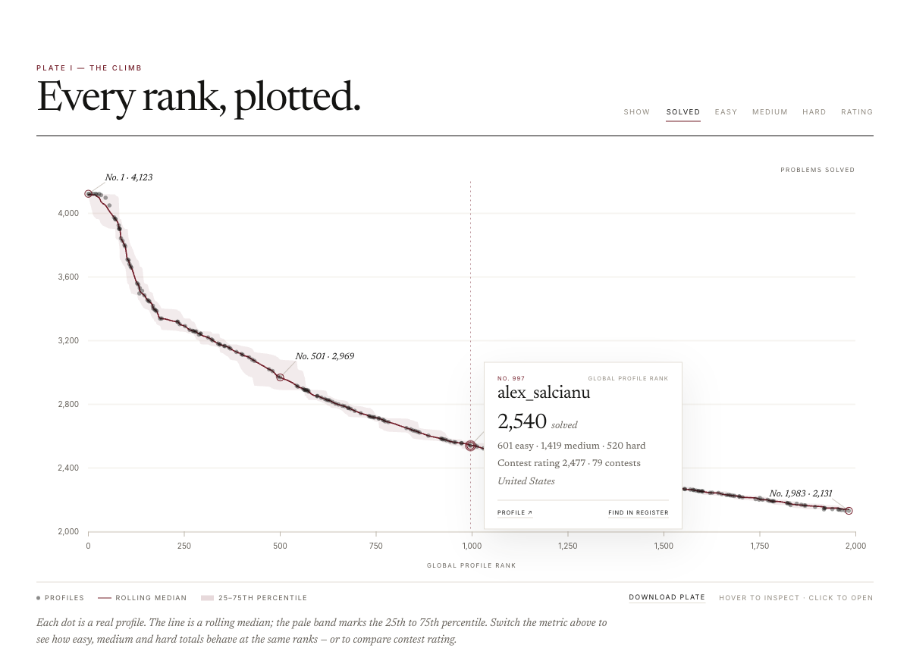
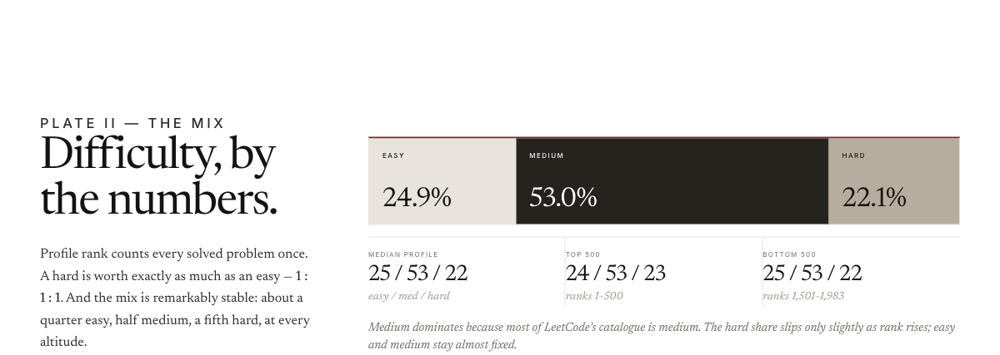
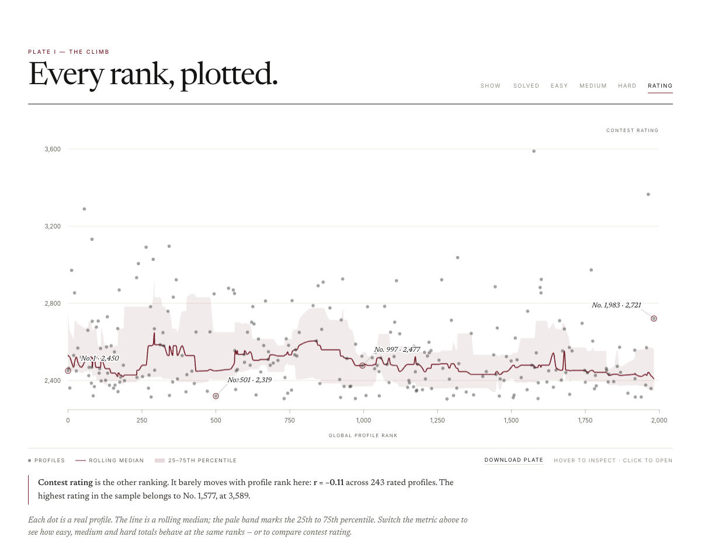
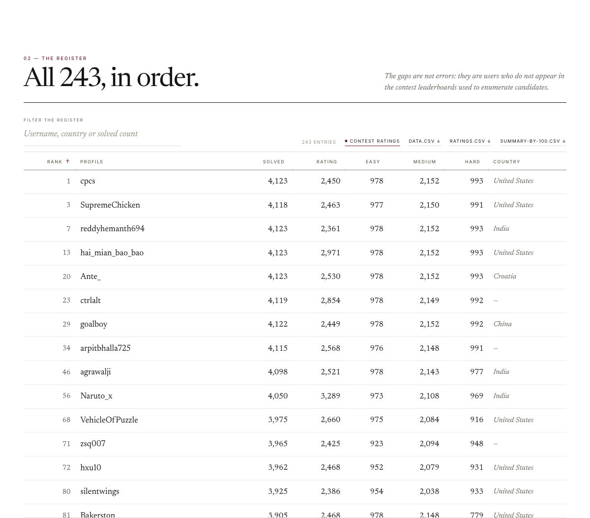
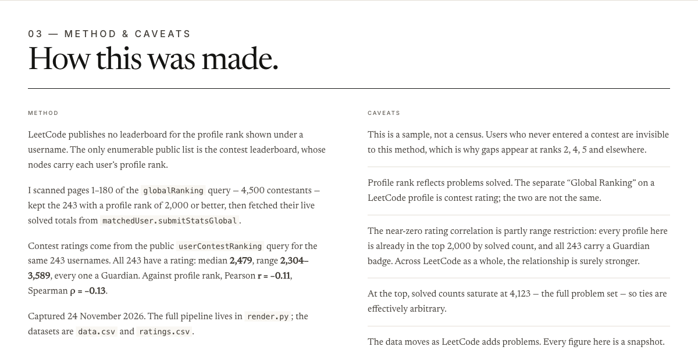

<p align="center">
  
</p>

<h1 align="center">The LeetCode Rank</h1>

<p align="center">
  <em>243 live profiles. Ranks 1–1,983.<br>The problems they solve — and the ratings that barely track them.</em>
</p>

<p align="center">
  <a href="https://abhinav-prabhakar.github.io/LeetCodeRankStudy/"></a>
  
  
  
</p>

<p align="center">
  
  
  
  
  
  
</p>

<p align="center">
  
  
  
  
</p>

<p align="center">
  <a href="https://abhinav-prabhakar.github.io/LeetCodeRankStudy/">
    
  </a>
</p>

<table align="center">
  <tr>
    <td align="center"><strong>243</strong><br><sub>profiles</sub></td>
    <td align="center"><strong>1–1,983</strong><br><sub>global rank</sub></td>
    <td align="center"><strong>2,131–4,123</strong><br><sub>problems solved</sub></td>
    <td align="center"><strong>2,479</strong><br><sub>median rating</sub></td>
    <td align="center"><strong>99.98<sup>th</sup></strong><br><sub>at the cut-off</sub></td>
  </tr>
</table>

<br>

## The climb

<p align="center">
  
</p>

At the very top, the problem set runs out before the ambition does: rank 1 has solved all **4,123** problems. From there the bands compress: the median of the top 500 sits at **3,403** solved, the next 500 at **2,723**, the next at **2,421**, and the last at **2,216**.

By rank 2,000 the curve is almost flat. Between the 1,000th and 2,000th places, a thousand ranks separate users by about **500** problems — less a measure of effort than of time, attrition, and which problems LeetCode has added this month.

<br>

## The weighting

Profile rank counts every solved problem once. An easy is worth exactly as much as a hard — **1 : 1 : 1** — and the mix barely moves with rank: **24.9% easy, 53.0% medium, 22.1% hard** across all 243 profiles. The median profile is **25 / 53 / 22**; the top 500 is 24 / 53 / 23, the bottom 500 25 / 53 / 22.

<p align="center">
  
</p>

<br>

## The other ranking

Profile rank is a tally of problems solved. Contest rating is something else: speed, under a clock, against everyone else in the room. We pulled both.

Across all 243 profiles the two are nearly unrelated — **Pearson r = −0.11**, **Spearman ρ = −0.13**. The top 500 has a median rating of **2,479**; the last 500, **2,452**. The highest rating in the sample, **3,589**, belongs to No. 1,577. The second-highest, **3,365**, belongs to No. 1,964. Every profile carries a Guardian badge.

<p align="center">
  
</p>

| Median rating | Range | Correlation with rank |
|:--:|:--:|:--:|
| **2,479** | **2,304–3,589** | **−0.11** |

The caveat is range restriction. Everyone here is already in the top 2,000 by solved count, so the near-zero correlation describes the elite, not LeetCode as a whole. Across the full population, the relationship is surely stronger. Switch the chart to **Rating** on the live site to inspect any dot.

<br>

## The register

<p align="center">
  
</p>

Every sampled profile, searchable by username, country or solved count. Toggle **Contest ratings** to add the second number. The gaps are real: they are users who never appear in the contest leaderboards used to enumerate candidates.

<p align="center">
  <a href="https://abhinav-prabhakar.github.io/LeetCodeRankStudy/"></a>
  <a href="data.csv"></a>
  <a href="summary-by-100.csv"></a>
  <a href="ratings.csv"></a>
</p>

<br>

## Method, in three lines

**Scan.** Pages 1–180 of LeetCode’s `globalRanking` query — 4,500 contestants.

**Filter.** Keep every node whose `user.profile.ranking` is 2,000 or better.

**Fetch.** Pull live `submitStatsGlobal` totals for the 243 that remain — and `userContestRanking` ratings for the same usernames.

<p align="center">
  
</p>

It is a sample, not a census. Users who never entered a contest are invisible, which is why the register has gaps at ranks 2, 4, 5 and elsewhere. Profile rank is solved-count rank — the separate “Global Ranking” on LeetCode is contest rating. The near-zero rating correlation is range-restricted: every profile here is already elite by volume. Captured **24 November 2026**; the numbers move as LeetCode adds problems.

<br>

## Files

| | |
|:--|:--|
| [`data.csv`](data.csv) | 243 profiles · rank, username, total / easy / medium / hard, country |
| [`ratings.csv`](ratings.csv) | The same 243 · contest rating, contests, global rank, top %, badge |
| [`summary-by-100.csv`](summary-by-100.csv) | 20 rank bands · count, median, min, max |
| [`chart.png`](chart.png) | The 2000 × 1100 plate, ready to print or embed |
| [`report.html`](report.html) | Self-contained report with the chart embedded |
| [`render.py`](render.py) | Rebuilds the plate, report, social card, favicons, and `docs/` |
| [`docs/`](docs/) | The GitHub Pages build served from `main` / `docs` |

<br>

## Run it

```bash
python3 -m venv .venv && source .venv/bin/activate
pip install pillow
python3 render.py
open docs/index.html
```

`render.py` reads `data.csv` and joins the optional `ratings.csv` by username; remove the ratings file to build the solved-only edition. It writes `chart.png`, `report.html`, and the complete `docs/` site. Commit `docs/` to publish.

<br>

<p align="center">
  <sub>Newsreader &amp; Inter · D3 · Python / Pillow · LeetCode GraphQL<br>
  Not affiliated with LeetCode · Data captured 24 November 2026</sub>
</p>

<p align="center">
  <a href="https://github.com/Abhinav-Prabhakar/LeetCodeRankStudy">GitHub</a> ·
  <a href="https://abhinav-prabhakar.github.io/LeetCodeRankStudy/">Live site</a> ·
  <a href="data.csv">CSV</a> ·
  <a href="ratings.csv">Ratings</a>
</p>
